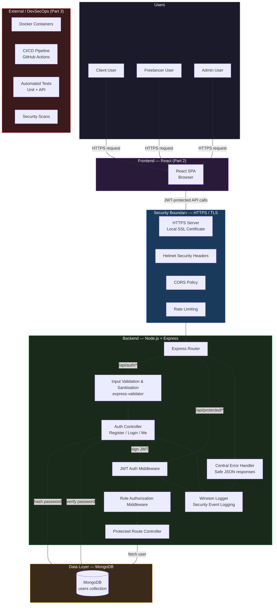

# HustleHub+ — Architecture Diagram (MERN)



## System Boundaries

| Boundary | Description |
|---|---|
| **HTTPS / TLS** | All traffic between the browser and the server is encrypted using a locally configured SSL certificate. This protects credentials and JWTs in transit. |
| **Security Headers** | Helmet sets HTTP headers that prevent clickjacking, MIME sniffing, and other common attacks. |
| **Rate Limiting** | Limits the number of requests per IP window to prevent brute-force and abuse. |
| **JWT Authentication** | Protected routes require a valid Bearer token. The token is verified on every request. |
| **Role Authorization** | Admin-only routes are gated by role-based middleware. |
| **Input Validation** | All user input is validated and sanitised before processing. |
| **Error Handling** | Errors are caught centrally and returned as safe JSON. Stack traces, file paths, and configuration are never exposed. |
| **MongoDB** | The database is accessed only through the backend API. No direct client-to-database access exists. |

## Request Flow

```
User → Browser (React SPA) → HTTPS → Helmet → CORS → Rate Limit → Express Router
  → Validation → Controller → MongoDB → Response → Error Handler (if needed) → User
```

## Technology Stack (MERN)

| Layer | Technology |
|---|---|
| Database | MongoDB |
| Backend | Node.js, Express |
| Frontend | React (added in Part 2) |
| Auth | JWT (jsonwebtoken), bcryptjs |
| Security | Helmet, CORS, Rate Limiting, express-validator |
| Logging | Winston |
| Testing | Jest, Supertest (Part 3) |
| DevOps | Docker, GitHub Actions (Part 3) |
